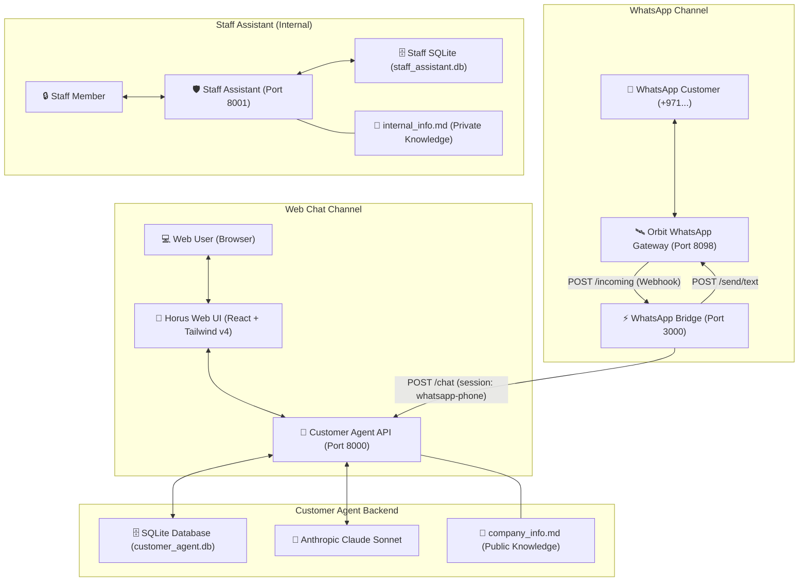

# Octapus AI Agents — Complete System Documentation

Comprehensive architecture, integration guide, and API reference for the **Octapus AI Agents Platform**, including the **Customer Agent (Web & WhatsApp)**, **Orbit WhatsApp Gateway Bridge**, **Persistent SQLite Database**, and the internal **Staff Assistant**.

---

## 1. System Architecture Overview



---

## 2. Platform Components

| Component | Port / Path | Tech Stack | Role |
| :--- | :--- | :--- | :--- |
| **Customer Agent Web UI** | `http://localhost:8000` | React 18, Vite, Tailwind v4, shadcn UI | Public website chat with Horus coordinator persona, audio recording, image upload, and TTS reading. |
| **Customer Agent API** | `http://localhost:8000/chat` | Python, FastAPI, Anthropic SDK | Answers inquiries using strict `company_info.md` rules. Never invents pricing or policies. |
| **Customer Agent Database** | `customer-agent/customer_agent.db` | SQLite 3 (WAL mode) | Persists sessions, complete conversation history, channel origins, and leads across restarts. |
| **WhatsApp Orbit Bridge** | `http://localhost:3000` | Node.js, Express.js | Two-way bridge connecting Orbit Gateway to Customer Agent with phone normalization and loop filtering. |
| **Orbit WhatsApp Gateway** | `http://localhost:8098` | Go, whatsmeow | Multi-device WhatsApp client connected to official business WhatsApp number (`+971528724090`). |
| **Staff Assistant** | `http://localhost:8001` | FastAPI, Multi-LLM Adapters | Internal password-protected assistant with tool execution, memory engine, and token budgeting. |

---

## 3. Persistent SQLite Database Layer

The Customer Agent incorporates a persistent SQLite database ([`customer-agent/db.py`](file:///Users/ceooctapus/Downloads/octapus-agents/customer-agent/db.py)) configured with Write-Ahead Logging (`WAL`) mode and thread safety.

### Database Tables Schema

#### `sessions` Table
Tracks distinct conversation threads from both Web visitors and WhatsApp contacts.
```sql
CREATE TABLE IF NOT EXISTS sessions (
    id TEXT PRIMARY KEY,                 -- UUID or "whatsapp-<phone>"
    channel TEXT NOT NULL DEFAULT 'web', -- 'web' or 'whatsapp'
    customer_phone TEXT,                 -- e.g. "971525919933"
    customer_name TEXT,                  -- Optional customer name
    message_count INTEGER DEFAULT 0,
    created_at TEXT NOT NULL,            -- ISO 8601 UTC
    updated_at TEXT NOT NULL             -- ISO 8601 UTC
);
```

#### `messages` Table
Maintains full chronological message transcripts for conversational context.
```sql
CREATE TABLE IF NOT EXISTS messages (
    id TEXT PRIMARY KEY,                 -- UUID
    session_id TEXT NOT NULL,            -- Foreign key to sessions.id
    role TEXT NOT NULL,                  -- 'user' or 'assistant'
    content TEXT NOT NULL,               -- Message text
    created_at TEXT NOT NULL,            -- ISO 8601 UTC
    FOREIGN KEY (session_id) REFERENCES sessions(id) ON DELETE CASCADE
);
```

#### `leads` Table
Stores contact inquiries and lead records.
```sql
CREATE TABLE IF NOT EXISTS leads (
    id TEXT PRIMARY KEY,
    session_id TEXT,
    phone TEXT,
    name TEXT,
    notes TEXT,
    status TEXT DEFAULT 'new',
    created_at TEXT NOT NULL,
    updated_at TEXT NOT NULL
);
```

---

## 4. WhatsApp Orbit Gateway Integration

### Data Flow
1. **Incoming Customer Message**:
   - Customer sends a WhatsApp message to `+971528724090`.
   - Orbit Gateway receives event `Message` and dispatches HTTP POST payload to `http://localhost:3000/incoming`.
2. **Bridge Parsing & Normalization**:
   - Extracts phone number from `data.Info.Sender` or `data.Info.Chat`.
   - Automatically normalizes UAE format (`05...` -> `9715...`).
   - Rejects outgoing messages (`IsFromMe: true`) to eliminate recursive reply loops.
   - Ignores group broadcast messages (`@g.us`).
3. **Agent AI Execution**:
   - Bridge calls `POST http://localhost:8000/chat` with `session_id: "whatsapp-<cleanNumber>"`.
   - Customer Agent queries SQLite for past conversation context (last 20 messages).
   - Agent invokes Claude Sonnet 5.5 bounded by `company_info.md`.
   - Stores new user & assistant messages into SQLite.
4. **Outgoing Delivery**:
   - Bridge receives reply and calls `POST http://localhost:8098/send/text` with `{ number: "<cleanNumber>", text: "<reply>" }`.
   - WhatsApp user receives instant intelligent reply.

---

## 5. API Reference

### Customer Agent API (`http://localhost:8000`)

#### `POST /chat`
Submits a message and receives the AI response.
- **Request Body**:
  ```json
  {
    "message": "What services do you provide?",
    "session_id": "whatsapp-971525919933"
  }
  ```
- **Response**:
  ```json
  {
    "reply": "Octapus LLC offers: Website design, Payment integration, ERP software, WhatsApp integration...",
    "session_id": "whatsapp-971525919933"
  }
  ```

#### `GET /health`
Returns system status and database statistics.
- **Response**:
  ```json
  {
    "status": "ok",
    "app": "octapus-customer-agent",
    "model": "claude-sonnet-5-5",
    "database": {
      "status": "connected",
      "engine": "sqlite",
      "db_path": ".../customer-agent/customer_agent.db",
      "total_sessions": 12,
      "total_messages": 48,
      "whatsapp_sessions": 8,
      "web_sessions": 4
    }
  }
  ```

#### `GET /sessions`
Lists all recent customer sessions with message counters and latest messages.

#### `GET /sessions/{session_id}/messages`
Fetches chronological conversation history for a specific customer or phone number.

#### `POST /chat/reset`
Clears chat history for a given `session_id`.

---

### WhatsApp Bridge API (`http://localhost:3000`)

#### `POST /incoming`
Webhook receiver for Orbit WhatsApp Gateway.
- Acknowledges Orbit with HTTP `200 OK` immediately.
- Asynchronously queries Customer Agent and dispatches WhatsApp reply.

#### `GET /health`
Bridge health and dependency check:
```json
{
  "status": "ok",
  "service": "octapus-whatsapp-bridge",
  "gateway": "http://localhost:8098",
  "agent": "http://localhost:8000/chat",
  "database": {
    "status": "connected",
    "engine": "sqlite"
  }
}
```

---

## 6. How to Run Locally

### Prerequisites
- Python 3.10+ with virtual environment at `.venv`
- Node.js 18+ (tested on Node v24)
- Running Orbit Gateway instance on `http://localhost:8098`

### 1. Configure Environment (`.env`)
```bash
# LLM API
ANTHROPIC_BASE_URL="https://api.mwapi.dev"
ANTHROPIC_API_KEY="sk-..."

# Staff Assistant
STAFF_PASSWORD="octapus-dev-staff-2026"
MASTER_KEY="octapus-dev-master-key-2026"

# WhatsApp / Orbit Gateway
GATEWAY_URL="http://localhost:8098"
GATEWAY_API_KEY="f358885b7f1f9ac6dd97201ee6323caa43e431a9b043e421a184f5246b9d5722"
BRIDGE_PORT="3000"
AGENT_URL="http://localhost:8000/chat"
```

### 2. Start All Services with Unified Dev Runner
```bash
# Runs Customer Agent (8000), Staff Assistant (8001), and WhatsApp Bridge (3000)
.venv/bin/python3 run_dev.py --with-bridge
```

### 3. Or Start Services Individually
```bash
# Terminal 1: Customer Agent
cd customer-agent
../.venv/bin/uvicorn app:app --reload --port 8000

# Terminal 2: WhatsApp Bridge Daemon
node whatsapp-bridge.js

# Terminal 3: Staff Assistant
cd staff-assistant
../.venv/bin/uvicorn app:app --reload --port 8001
```

---

## 7. Connecting WhatsApp Gateway (Orbit)

To connect or re-register Orbit Gateway to the bridge webhook:

```bash
curl -X POST 'http://localhost:8098/instance/connect' \
  -H 'apikey: f358885b7f1f9ac6dd97201ee6323caa43e431a9b043e421a184f5246b9d5722' \
  -H 'Content-Type: application/json' \
  -d '{
    "webhookUrl": "http://localhost:3000/incoming",
    "subscribe": ["ALL"],
    "rabbitmqEnable": ""
  }'
```

To verify Orbit instance status:
```bash
curl -H 'apikey: f358885b7f1f9ac6dd97201ee6323caa43e431a9b043e421a184f5246b9d5722' \
  http://localhost:8098/instance/status
```

---

## 8. Deployment Guidelines

1. **Customer Agent Web Frontend**:
   - Deployed on Vercel: `https://customer-agent-mauve.vercel.app`
   - Build command: `npm run build` in `customer-agent` directory.
2. **Customer Agent Backend**:
   - Can run as a containerized service (Docker) or AWS App Runner / EC2.
   - Filesystem: Ensure persistent storage volume mounted for `customer_agent.db`.
3. **WhatsApp Bridge & Orbit Gateway**:
   - Must share network reachability (e.g. Docker network or reverse proxy).
   - In production with public webhooks, set `WEBHOOK_URL="https://your-domain.com/incoming"` in Orbit.
4. **Security Notice**:
   - `staff-assistant` must never be exposed publicly without SSL and password protection.
   - Internal credentials and customer personal data must never be committed to git.
